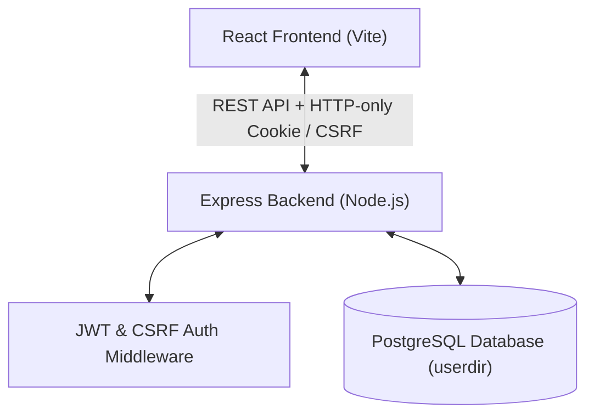

# e-Office Admin Panel

[](https://nodejs.org/)
[](https://expressjs.com/)
[](https://react.dev/)
[](https://vitejs.dev/)
[](https://www.postgresql.org/)
[](LICENSE)

An executive administration web dashboard built for managing user accounts, document records, system security, and audit logs within the **e-Office** platform ecosystem.

---

## Table of Contents

- [Architecture Overview](#architecture-overview)
- [Key Features](#key-features)
- [Project Structure](#project-structure)
- [Prerequisites](#prerequisites)
- [Installation & Setup](#installation--setup)
- [Running the Application](#running-the-application)
- [API & Usage Examples](#api--usage-examples)
- [Contributing](#contributing)
- [Support & Help](#support--help)
- [Maintainers](#maintainers)
- [License](#license)

---

## Architecture Overview



---

## Key Features

- 🔐 **Secure Admin Authentication**: JWT authentication stored in HTTP-only cookies with XSS and double-submit CSRF cookie mitigation.
- 👥 **User Account Management**: Search, filter, inspect, and toggle active/inactive account statuses in real time.
- 📄 **Document Oversight**: Centralized listing and management of user-uploaded document records.
- 📜 **Audit Log Tracking**: Full system event auditing with actor identification, IP logging, action tags, and temporal indexing.
- 🌓 **Adaptive Theme Engine**: Dynamic Light & Dark UI mode toggle powered by React Context and persistent CSS custom properties.

---

## Project Structure

```text
admin-panel/
├── client/                 # React 19 + Vite Frontend
│   ├── src/
│   │   ├── components/     # UI Components (Accounts, Audit, Dashboard, Layout, etc.)
│   │   ├── context/        # React Context (ThemeContext)
│   │   ├── App.jsx         # Application routing & protected routes
│   │   └── main.jsx        # Frontend entrypoint
│   └── package.json
├── controllers/            # Express route logic controllers
├── middleware/             # Security (CSRF) & Authentication (JWT) middleware
├── models/                 # Data access layer interacting with PostgreSQL
├── routes/                 # Express API endpoint definitions
├── db.js                   # PostgreSQL connection pool setup
├── seed-admin.js           # Admin account seeding script
├── server.js               # Express application backend entrypoint
├── setup.sql               # Database schema initialization script
└── package.json            # Backend dependencies & script definitions
```

---

## Prerequisites

- **Node.js**: v18.0.0 or higher
- **npm**: v9.0.0 or higher
- **PostgreSQL**: v14.0 or higher

---

## Installation & Setup

### 1. Clone the Repository

```bash
git clone https://github.com/arnav0406/eo-admin-panel.git
cd admin-panel
```

### 2. Environment Configuration

Create a `.env` file in the root directory based on the following template:

```env
PORT=5001
DB_USER=your_db_user
DB_HOST=localhost
DB_NAME=userdir
DB_PASSWORD=your_db_password
DB_PORT=5432
ADMIN_JWT_SECRET=your_secure_random_jwt_secret_key
FRONTEND_URL=http://localhost:5174
```

### 3. Database Initialization

Execute the SQL script [`setup.sql`](setup.sql) against your PostgreSQL database instance (`userdir`):

```bash
psql -U your_db_user -d userdir -f setup.sql
```

### 4. Install Dependencies

Install root backend dependencies:
```bash
npm install
```

Install frontend client dependencies:
```bash
cd client && npm install && cd ..
```

### 5. Seed Initial Admin User

Run the seeding script to create default administrator credentials:

```bash
npm run seed
```

> **Default Seed Credentials:**
> - **Email**: `admin@eoffice.gov.in`
> - **Password**: `admin123`
> *(Please change the default password immediately after initial login!)*

---

## Running the Application

### Concurrent Development Mode

Start both the backend Express server and Vite frontend client concurrently:

```bash
npm run dev
```

- **Backend API Server**: Runs on `http://localhost:5001`
- **Frontend Client App**: Runs on `http://localhost:5174`

### Running Backend or Frontend Separately

- Backend Server only:
  ```bash
  npm run server
  ```
- Frontend Client only:
  ```bash
  cd client && npm run dev
  ```

---

## API & Usage Examples

### Authentication Request Example

To authenticate as an admin, send a `POST` request to the auth endpoint:

```bash
curl -X POST http://localhost:5001/api/admin/auth/login \
  -H "Content-Type: application/json" \
  -d '{"email":"admin@eoffice.gov.in","password":"admin123"}' \
  -c cookies.txt
```

### Authenticated Admin Request (with CSRF header)

For state-changing actions (`POST`, `PUT`, `DELETE`), pass the CSRF token obtained from the `XSRF-TOKEN` cookie in the `X-CSRF-Token` header:

```bash
curl -X POST http://localhost:5001/api/admin/accounts/1/toggle-status \
  -b cookies.txt \
  -H "X-CSRF-Token: <csrf-token-value>"
```

---

## Contributing

Contributions are welcome! Please follow these steps to contribute:

1. Fork the repository.
2. Create a feature branch: `git checkout -b feature/amazing-feature`
3. Commit your changes: `git commit -m 'Add some amazing feature'`
4. Push to the branch: `git push origin feature/amazing-feature`
5. Open a Pull Request.

---

## Support & Help

If you encounter issues or have questions regarding the project:

- **Issue Tracker**: Submit bugs or feature requests via GitHub Issues.
- **Database Schema**: Refer to [`setup.sql`](setup.sql) for table structures and relationships.

---

---

## License

This project is licensed under the [MIT License](LICENSE).
